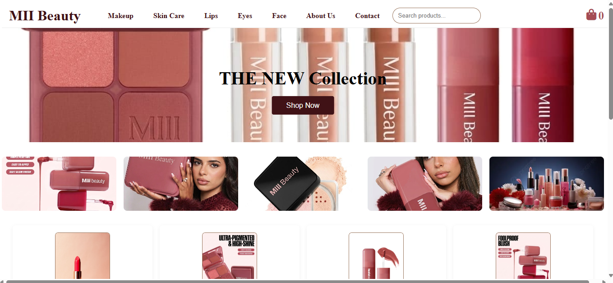
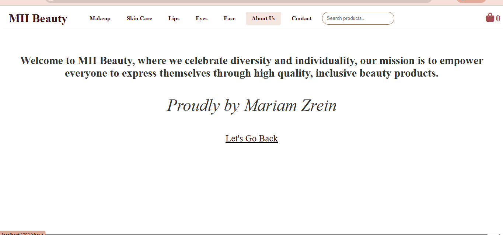
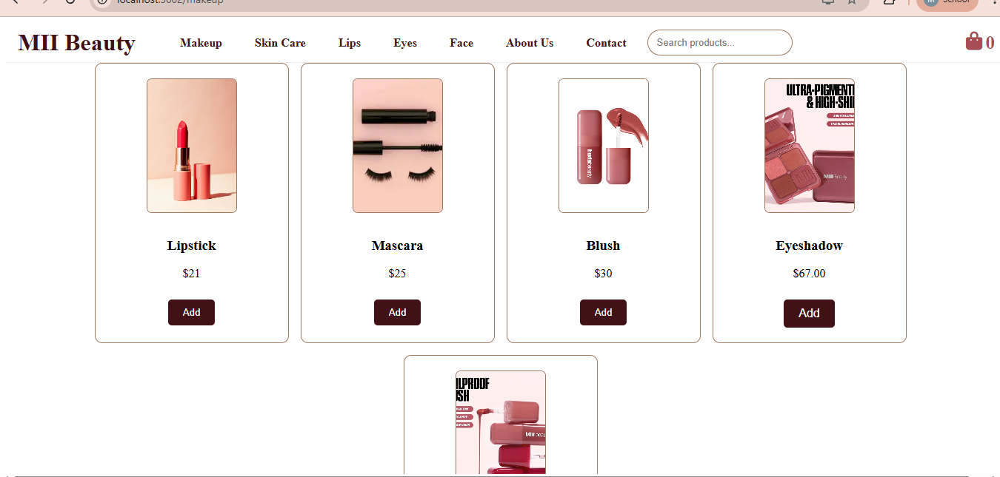
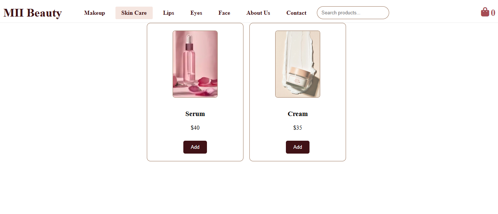
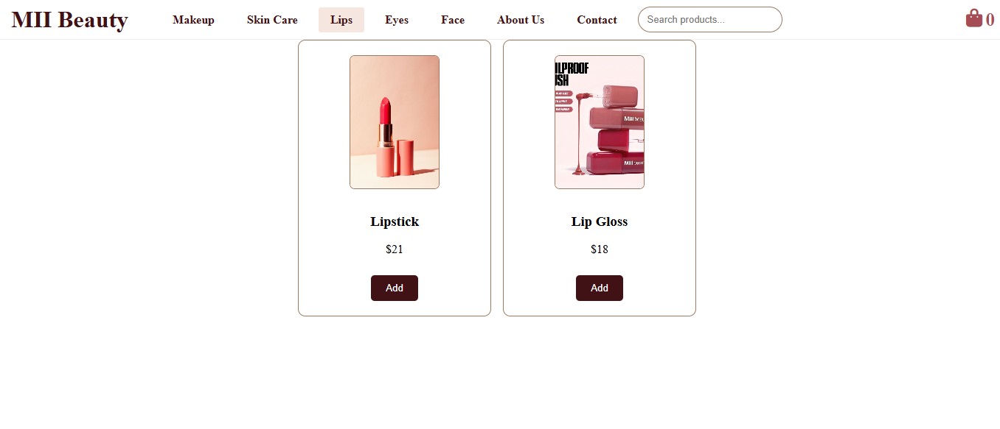
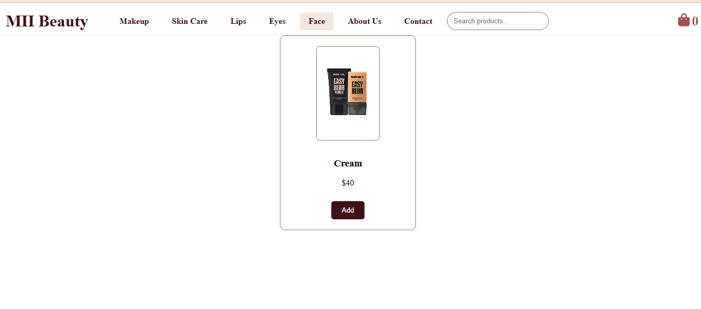
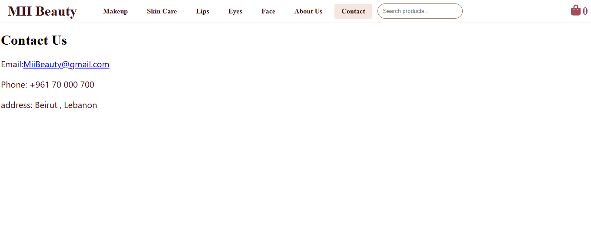
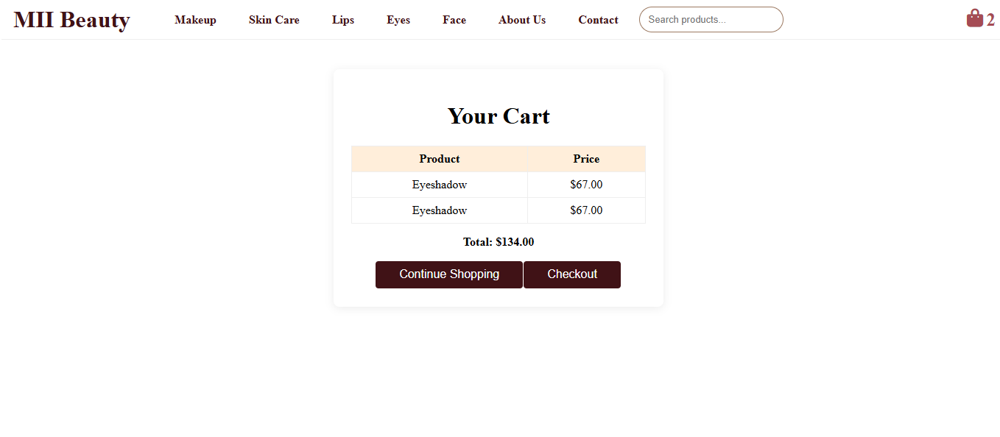
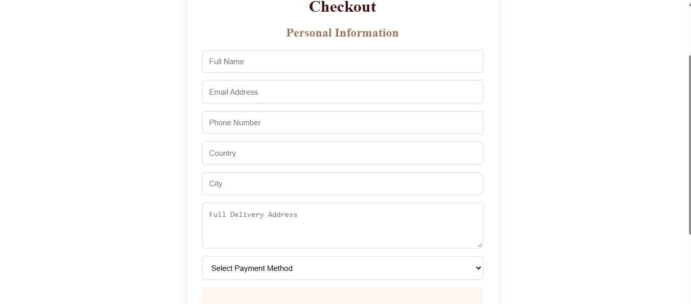
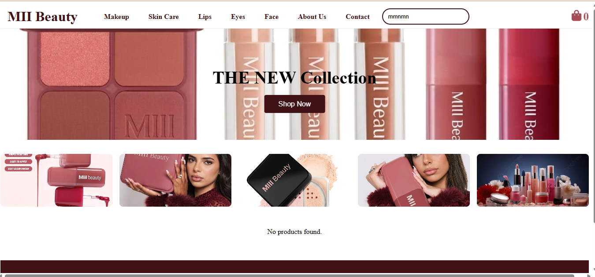

# MII Beauty

## Project Description
MII Beauty is a React-based beauty website that allows users to explore beauty products, browse categories, search for products, and manage a shopping cart.

## Features
- Home page
- About Us page
- Products and categories
- Product search
- Shopping cart
- Contact page
- Responsive design

## Technologies Used
- React.js
- JavaScript
- HTML
- CSS
- React Router
- Font Awesome

## Installation Instructions

1. git clone https://github.com/Mariamzrein/miiibeauty.git
2. cd miibeauty
3. Install dependencies:
   `npm install`

4. Start the application:
   `npm start`

## Screenshots

### Home Page

### About Us

### Products - Makeup

### Skincare

### Lips

### Face

### Contact

### Cart

### Checkout

### Search Bar

## Author
Mariam Zrein 22231009

## Course
CSCI426 – Advanced Web Programming
## Live Website

Visit MII Beauty: (https://miiibeauty.vercel.app/)
